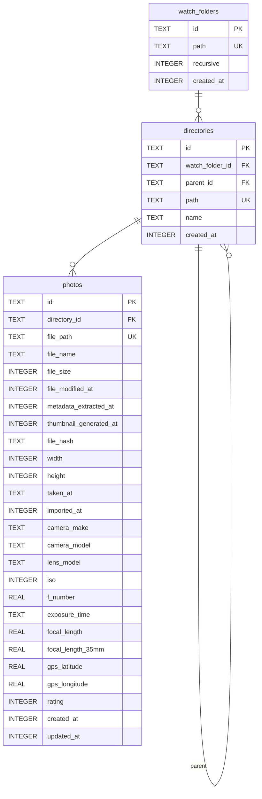

## 日時の型

- **INTEGER (UNIX TIME)** で統一。フォーマット不一致によるバグを防ぐ。
- 唯一の例外は `taken_at` — EXIFの `DateTimeOriginal` にタイムゾーン情報がないため、TEXTで生データを保存する。
- DB閲覧時は `SELECT datetime(created_at, 'unixepoch') FROM photos` で人間が読める形式に変換できる。
