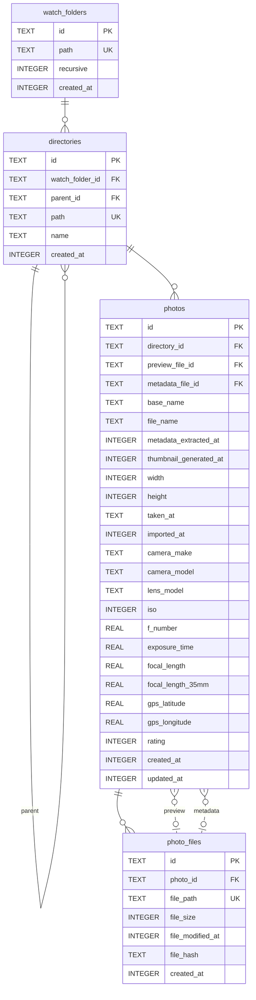

## photos と photo_files の関係

1枚の写真に複数ファイル（JPEG+RAWペア等）が紐付く 1:N 関係。

`photos.preview_file_id` / `metadata_file_id` は `photo_files` への参照で、どのファイルを表示・EXIF抽出に使うかを保持する。スキャナがファイル種別の優先順位に従って選択し、`UPDATE` する。

- **preview_file_id**: `photo://` 配信元、サムネ生成元
- **metadata_file_id**: EXIF抽出元
- **base_name**: 拡張子を除いたファイル名。`(directory_id, base_name)` で一意（`COLLATE NOCASE`）。ペアリングのキー
- **file_name**: `preview_file` の basename を複製。ソート（`sort:name`）と一覧表示で使う

参照先が `ON DELETE` で消えても写真自体は残るよう、両FKは `SET NULL`。`photo_files` 側は `photos` 削除時に `CASCADE`。`preview_file_id` 更新時は `file_name` も同時に更新する。

## ファイル種別

`file_path` の拡張子から都度導出する（DBには持たない）。

| 種別 | 拡張子 | photo:// 配信 |
|------|--------|--------------|
| `jpeg` | jpg, jpeg | 直接配信 |
| `heif` | heic, heif | 直接配信 |
| `tiff` | tif, tiff | 直接配信 |
| `png` | png | 直接配信 |
| `webp` | webp | 直接配信 |
| `gif` | gif | 直接配信 |
| `bmp` | bmp | 直接配信 |
| `raw` | cr2, cr3, nef, arw, raf, dng, orf, rw2, pef | redbプレビューキャッシュ経由 |

- `preview_file_id` 選択優先: `jpeg > heif > tiff > png > webp > gif > bmp > raw`
- `metadata_file_id` 選択優先: `raw > tiff > jpeg > heif > png > webp > gif > bmp`

## 日時の型

- **INTEGER (UNIX TIME)** で統一。フォーマット不一致によるバグを防ぐ。
- 唯一の例外は `taken_at` — EXIFの `DateTimeOriginal` にタイムゾーン情報がないため、TEXTで生データを保存する。
- DB閲覧時は `SELECT datetime(created_at, 'unixepoch') FROM photos` で人間が読める形式に変換できる。
